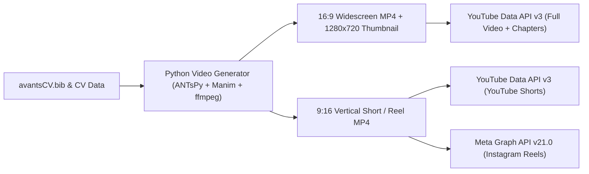

# Executive Visual CV: Instagram & YouTube Automation Strategy

**Author / Brand:** Brian B. Avants, Ph.D. · Cingulate LLC · ANTsX Ecosystem  
**Web Portfolio:** [https://stnava.github.io/CV/](https://stnava.github.io/CV/)  
**Interactive Mockup:** [`../instagram_cv_concept.html`](../instagram_cv_concept.html)

---

## Part 1: Instagram Visual CV & Venture Portfolio Strategy

Because your work sits at the intersection of **computational anatomy, diffeomorphic flows, multi-modal brain mapping, and AI**, an Instagram presence functions as a **Visual Executive CV & Venture Portfolio**—turning cortical thickness maps, geodesic velocity fields, Stiefel manifold trajectories, and clinical trial visualizations into high-impact scientific art.

### 1.1 Recommended Handles

| Handle | Strategic Positioning | Rationale |
| :--- | :--- | :--- |
| **`@antsx.ai`** *(Top Pick)* | **Flagship Ecosystem + AI Executive** | Aligns directly with `antsx@antsx.com` and the global recognition of **ANTsX**, while immediately signaling modern AI/ML leadership. |
| **`@cingulate.ai`** | **Venture & Boutique Consultancy** | Positions **Cingulate LLC** as a premier biotech/pharma AI & quantitative biomarker consultancy (while nodding to the cingulate cortex). |
| **`@brianavants.ai`** | **Personal Executive Brand** | Clean, authoritative personal handle ideal for keynote speaking, advisory boards, and executive networking. |
| **`@diffeomorphic`** | **Sci-Art & Mathematical Authority** | Category-owning scientific handle celebrating `SyN` diffeomorphisms, geodesic flows, and brain mapping aesthetics. |
| **`@stnava.ai`** | **Developer & Open-Source Identity** | Direct continuity with your GitHub handle (`github.com/stnava`) and web domain (`stnava.github.io`). |

### 1.2 Curated 150-Character Bio Options

* **Option A — Entrepreneurial & Executive (146 characters):**
  ```text
  AI & Neuroimaging Executive | Founder @ Cingulate LLC 🧠
  Creator of ANTsX & SyN (57K+ citations · h-index 71)
  Translating math & ML into biomarkers
  🔗 stnava.github.io/CV
  ```
* **Option B — Founder & Pharma AI Strategist (144 characters):**
  ```text
  Founder, Cingulate LLC | Co-Creator of ANTsX ⚡
  Ex-Invicro ML Director & Biogen Biomarkers Lead
  57,000+ citations in Computational Anatomy & AI
  🔗 stnava.github.io/CV
  ```
* **Option C — Visual Science & Open-Source Pioneer (139 characters):**
  ```text
  Mapping the human brain with math & deep learning 🌐
  Creator: ANTsX · SyN · SiMLR · NSA-Flow
  57K+ Citations | Principal @ Cingulate LLC
  🔗 stnava.github.io/CV
  ```

### 1.3 Story Highlights Architecture (Evergreen Mini-Portfolios)

1. **`CV / Bio`** — 4-story executive summary: Career arc (UPenn $\rightarrow$ Biogen $\rightarrow$ Invicro $\rightarrow$ UVA & Cingulate LLC), 57K+ citations, and direct link to PDF/Web CV.
2. **`ANTsX`** — The open-source stack (`ANTs`, `ANTsPy`, `ANTsPyNet`, `ANTsPyMM`, `ANTsR`) and #1 benchmark wins (Klein, EMPIRE10, BRATS, SATA).
3. **`NSA-Flow`** — Visual explainers of Non-Negative Stiefel Approximating Flow (`nsa_flow` in PyTorch) and orthogonalish sparse embeddings.
4. **`SiMLR`** — Multi-view representation learning (*Nature Computational Science* 2021) from the Brown ICERM fellowship.
5. **`Trials/PET`** — The 2016 *Nature* Cover story (Aducanumab PRIME Amyloid PET), 3D super-resolution, and PPMI Parkinson's subtyping.
6. **`Blast/TBI`** — Special Operations & breacher neuroinflammation (TSPO PET) and the Normative Neuroimaging Library.

### 1.4 The 9-Post Launch Grid ("The Visual CV Grid")

All 9 launch slides (1080×1080 PNG/SVG) and captions are pre-built in [`../instagram/posts/`](../instagram/posts/):

1. **`post_01_visual_cv` (Pinned):** *Brian B. Avants, Ph.D. — Visual Executive CV* (57,000+ citations, h-index 71, ANTsX, Cingulate LLC).
2. **`post_02_nature_cover` (Pinned):** *Behind the 2016 Nature Cover* (Confirmatory Amyloid PET SUVR optimization in the Aducanumab PRIME trial).
3. **`post_03_antsx_ecosystem` (Pinned):** *The ANTsX Ecosystem at Global Scale* (`ANTs`, `ANTsPy`, `ANTsPyNet`, `ANTsPyMM`, `ANTsR`).
4. **`post_04_nsa_flow`:** *Introducing `NSA-Flow` (PyTorch)* (Non-Negative Stiefel Approximating Flow for sparse, orthogonal, interpretable embeddings).
5. **`post_05_simlr`:** *`SiMLR` Multi-View AI* (Similarity-driven multi-view embeddings in *Nature Computational Science* 2021).
6. **`post_06_blast_tbi`:** *Mapping Invisible Wounds* (TSPO PET neuroinflammation & network effects of repetitive blast exposure in Special Operations personnel).
7. **`post_07_biobank_scale`:** *49,000+ Brains Mapped* (UK Biobank, PPMI & ADNI phenotyping; *Nature Medicine* 2024, *Scientific Reports* 2024, *ICLR* 2023).
8. **`post_08_syn_n4`:** *`SyN` & `N4ITK`* (The mathematical foundations behind 13,500+ citations and physical coordinate invariance).
9. **`post_09_cingulate_llc`:** *Cingulate LLC (Portsmouth, NH)* (Boutique AI, computational anatomy & clinical trial biomarker consultancy).

### 1.5 Instagram Automation Workflow

* **Generator Script:** [`../instagram/generate_posts.py`](../instagram/generate_posts.py) renders 1080×1080 SVG/PNG cards and parses [`../avantsCV.bib`](../avantsCV.bib) for new publications.
* **Graph API Publisher:** [`../instagram/publish_instagram.py`](../instagram/publish_instagram.py) publishes single images or multi-slide carousels via the official Meta Graph API (`v21.0`).
* **GitHub Actions Workflow:** [`../.github/workflows/instagram_publish.yml`](../.github/workflows/instagram_publish.yml) supports scheduled weekly runs or manual `workflow_dispatch` triggers.

---

## Part 2: Automated YouTube & Reels Video Pipeline Blueprint

We can extend the visual pipeline to automatically produce both **16:9 Widescreen YouTube Videos** (2–5 minute paper/software walkthroughs) and **9:16 YouTube Shorts / Instagram Reels** (30–60 second visual highlights), uploading them directly via the **YouTube Data API v3**.

### 2.1 Automated Video Generation Architecture (Zero Manual Editing)

Using Python, `ffmpeg`, and scientific rendering tools, an automated script can assemble broadcast-quality `.mp4` videos from your CV, `avantsCV.bib`, or imaging outputs:

1. **Visual Layer (Programmatic Animation & Neuroimaging Renders):**
   * **Slide & Motion Graphics (`ffmpeg` / `Manim` / HTML5 Canvas-to-Video):**
     * Smoothly animated title cards, mathematical equation reveals (`SyN` geodesic velocity fields, `NSA-Flow` Stiefel manifold trajectories, `SiMLR` multi-view matrices), and animated citation/benchmark counters.
   * **Anatomical & Clinical Trial Montages (`ANTsPy` / `matplotlib`):**
     * Automated 3D/2D orthogonal slice fly-throughs (Axial, Coronal, Sagittal) strictly adhering to physical coordinate invariance:
       * Respecting the direction cosine matrix, voxel spacing, origin, and true anatomical aspect ratios (`aspect = spacing_y / spacing_x`).
       * Adhering to standard radiological viewing convention (patient Right on viewer Left for axial/coronal views).
       * Co-registered contour/segmentation overlays resampled to the exact physical space grid of the underlay.
       * Direction-Encoded Color (DEC) diffusion tensor montages following standard DTI conventions (Red = Left-Right, Green = Anterior-Posterior, Blue = Inferior-Superior).
     * Dynamic registration warps (moving $\rightarrow$ template geodesic morphing), `DiReCT` cortical thickness maps, and 3D super-resolution before/after comparisons.

2. **Audio & Voiceover Layer:**
   * **Script Generation:** Auto-synthesizes a structured, engaging narration script from a paper abstract (`avantsCV.bib`), software release note, or clinical trial case study.
   * **Voice Synthesis:** Uses neural TTS (e.g., ElevenLabs API with optional voice cloning of your own voice, OpenAI TTS, or local offline Kokoro/Piper TTS) paired with subtle ambient background audio ducking via `ffmpeg`.

3. **Synchronized Captions & Chapters:**
   * Generates word-level `.srt` / burned-in dynamic subtitles (essential for high retention on YouTube Shorts and Instagram Reels).
   * Automatically generates YouTube timestamp chapters in the video description (`00:00 Executive Summary`, `00:45 Mathematical Formulation`, `01:45 UK Biobank & Clinical Trial Results`, `02:30 Open-Source Code in ANTsX`).

### 2.2 High-Impact YouTube Series Concepts

1. **"60 Seconds of Computational Anatomy" (YouTube Shorts + IG Reels, 9:16, 1080×1920):**
   * Visual warps showing `SyN` diffeomorphic registration, `N4ITK` bias correction before/after, 3D concurrent super-resolution, and `NSA-Flow` feature sparsification on the Stiefel manifold.
2. **"Paper & Code Spotlights" (YouTube Widescreen, 16:9, 1920×1080, 3–5 mins):**
   * Auto-generated video abstracts for 2024–2026 papers (*Deep Computational Anatomy via Latent-Aligned Multiview Normalizing Flows*, *NSA-Flow*, *UK Biobank ANTsX Phenotypes*, *Special Operations Blast Neurotrauma*, *MRI2PET*).
3. **"Executive & Clinical Trial AI Briefings" (YouTube Widescreen, 16:9, 2–3 mins):**
   * Case studies on how quantitative imaging biomarkers (Amyloid/Tau/TSPO PET, `ANTsPyMM` automated QC, longitudinal subtyping via `subtyper` and Aligned-UMAP) de-risk Phase I–III drug trials—ideal for biotech and pharmaceutical sponsors discovering **Cingulate LLC**.

### 2.3 Automated YouTube & Cross-Platform Publishing (`YouTube Data API v3`)



* **One-Time OAuth Setup:** Create a Google Cloud OAuth 2.0 client with the `https://www.googleapis.com/auth/youtube.upload` scope and store the `refresh_token` in environment variables or GitHub Secrets.
* **Automated Upload (`publish_youtube.py`):** Uploads the rendered `.mp4`, sets the title, formatted description (with DOI links, GitHub repo links, and `https://stnava.github.io/CV/`), tags, custom 1280×720 thumbnail, playlist assignment, and publication schedule.
* **Single-Render, Dual-Platform Publishing:** Every 9:16 vertical video can be published simultaneously to **YouTube Shorts** and **Instagram Reels** (by passing `media_type="REELS"` and `video_url` to the Meta Graph API).
